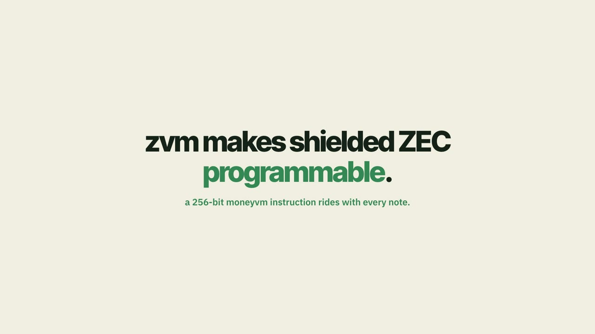
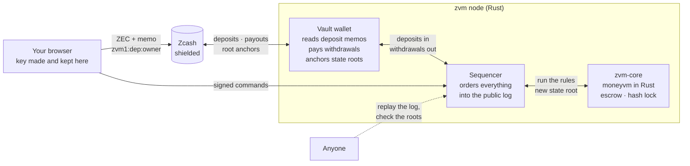

# zvm: programmable money for shielded Zcash

zvm lets shielded ZEC carry rules. You deposit ZEC with a memo and receive a **note**: the same money, now holding a
256-bit moneyvm instruction that runs on every transfer. A note can expire, unlock on a
date, sit in escrow until an arbiter decides, wait behind a hash lock, or refuse any single transfer above a cap,
whoever holds it. When you leave, the vault pays you shielded ZEC again.

[](https://youtu.be/x5zrCNWS_rY)

Zcash has no smart contracts. zvm runs the VM off-chain as a deterministic state machine and uses Zcash for what it
does best: moving money in and out privately, and timestamping the VM's state root in a shielded memo.

- **Public demo** (stand-in chain, pretend money, try everything): https://zvm-demo.fly.dev
- **Demo video** (1:51, narrated): https://youtu.be/x5zrCNWS_rY
- **Full walkthrough** (2:50, every feature step by step): _link added after upload_
- **Mainnet vault**: see [Mainnet](#mainnet)

The public demo resets each time it restarts, so you can't break it for the next person. Open it in two browsers
(or switch keys from the header) to play two people, for example sender and arbiter in an escrow.

## What you can do

| | What happens | moneyvm feature |
|---|---|---|
| **Deposit** | Send shielded ZEC to the vault with memo `zvm1:dep:<owner id>`. After 2 confirmations you hold a note for that amount. Optionally lock it until a date or make it expire. | token id with time mode |
| **Send** | Move part or all of a note to another owner id. Every rule on it runs first; if one refuses, nothing moves. | transfer + `CoprocessorVM` |
| **Program** | Attach a rule: freeze, only to one person, not before a date. Or, as the depositor, set issuer rules that follow every piece of that money: a spending cap, two allowed recipients. Rules are one-way. | 2CB instruction, base sequence |
| **Escrow** | Lock a note for a recipient. The arbiter releases or refunds it; after expiry the sender can take it back. | escrow extension |
| **Hash lock** | Lock a note behind a secret. The recipient claims it by revealing the secret, as in an atomic swap. | HTLC extension |
| **Withdraw** | Sign a "cheque": the vault pays shielded ZEC to your address with memo `zvm1:out:<log entry>`. Withdrawing is a transfer out of the VM, so rules still apply. | transfer to `EXIT` |
| **Audit** | Download the signed log, replay it, check every state root and the roots anchored on Zcash. | |

Keys are ed25519, made and kept in your browser. Your owner id is the first 20 bytes of
`SHA3-256("zvm-owner-v1" ‖ public key)`, the width moneyvm's ISA expects for an address.

## How it works



- **`core/`**: moneyvm ported from Solidity to Rust. No I/O and no clock of its own: block time and height arrive with
  each command, so the same log always produces the same state.
- **`node/`**: the `zvm` binary. Sequencer (signed commands with nonces, append-only `log.jsonl` with the block,
  time and state root of every entry), HTTP API, web app server, and the vault loop: every 20 s it syncs the wallet,
  credits deposits with 2 confirmations, pays queued withdrawals (fee 0.00015 ZEC, taken from the amount) and, when
  the log has changed, anchors the latest root in a memo `zvm1:root:<index>:<root>` (at most every 30 min).
- **`wallet/`**: a small shielded wallet on librustzcash 0.24 (Orchard and Sapling), syncing from a public
  lightwalletd.
- **`web/`**: the app. No framework, no build step. Deposits are paper deposit slips, notes are printed like
  banknotes with their rules and serial on the face, and withdrawals are signed cheques.
- **`e2e/`**: a browser test that walks three users through every feature.
- **`deploy/`, `Dockerfile`, `fly.toml`**: the public demo (a stand-in-chain node on Fly.io).
- **`demo-video/`**: the scripts that record and edit the demo videos from the live app.

## Run it

Needs Rust 1.85+.

```bash
cargo build --release -p zvm-node
./target/release/zvm init --dir demo --network 1 --admin 0x00000000000000000000000000000000000000ad
./target/release/zvm serve --dir demo --fake          # stand-in chain: deposits by button, no wallet
open http://127.0.0.1:8790
```

On mainnet:

```bash
./target/release/zvm wallet-init --wallet ~/.zvm/vault --network main   # recovery phrase in seed.txt there, never printed
./target/release/zvm init --dir ~/.zvm/data --network 1 --admin <your owner id>
./target/release/zvm serve --dir ~/.zvm/data --wallet ~/.zvm/vault [--publish-viewing-key]
```

Other commands: `zvm replay --dir <data>`, `zvm wallet-info`, `zvm keygen --out key.txt`,
`zvm submit --key key.txt --cmd '{"op":"transfer",...}'`, `zvm owner <pubkey>`.

Tests: `cargo test` (28 tests: codec round-trips, ALU and control flow, ledger, escrow, HTLC, moneyvm's freeze
constant byte for byte, a scaled-down version of its tainted-branch scenario, sequencer replay and tamper detection,
memo parsing). End to end in a browser: `node e2e/walk.mjs` against a `--fake` node (three users, 13 checks);
set `ZVM_URL=https://zvm-demo.fly.dev` to run it against the public demo.

### Host the demo

```bash
fly deploy        # builds the Dockerfile; deploy/demo.sh starts a fresh --fake node on every boot
```

The demo holds no keys and no real money. The mainnet vault runs separately, on the operator's machine.

## Check the operator

1. Download the log: `GET /api/log`.
2. `zvm replay --dir <folder with config.json and log.jsonl>` rebuilds the state from zero and stops at the first entry
   whose root does not match.
3. Compare the roots with the ones anchored on Zcash (memo `zvm1:root:…`). With the vault's viewing key
   (`--publish-viewing-key`), any Zcash wallet shows every deposit, payout and anchor, so the log can be matched
   against the chain both ways.

## Trust model and privacy

What zvm is today, plainly:

- **Custody is the operator's.** One wallet holds the deposited ZEC. The log and anchors make cheating visible, not
  impossible. Roadmap: FROST threshold custody, so no single key can pay out.
- **On Zcash, money in and out is shielded.** Deposits and payouts are ordinary shielded transactions: the chain
  does not show sender, recipient, amount or memo.
- **Inside zvm, the log is public.** Anyone can see which owner id sent how much to which owner id. Owner ids are
  pseudonymous keys, and nothing links them to Zcash addresses except a deposit memo or a payout address, which only
  the viewing key reveals. That is the price of a log anyone can replay. Roadmap: prove each batch in a zkVM (the core
  is pure Rust for this reason) and publish only proofs and roots.
- **Fees.** Anchors are paid from the vault's own balance, so the operator keeps a small buffer (a deposit without a
  memo) to stay fully backed.

## Credits

zvm is built on **moneyvm** by Sirawit Techavanitch (Apache-2.0), used with the author's permission. Issues found in
moneyvm while porting are listed in [PLAN.md](PLAN.md#upstream-issues-found-while-porting-to-report-to-the-moneyvm-author).

## Mainnet

Vault (unified address):
`u10aqfuyu7mdrfs8kawl0tqtz8vt4h592avlke08f6uawgelaugqhzkuyhzv0unrxnanm0qq9n2c4rdtdef5v0legl5d7gmqv4pw7kehs75g6jkc2hzyq0kryz2knngs43gk6vvz39vv65h8wj8n833wp47nf0c09pqqf7vzlshsky0pwq`
